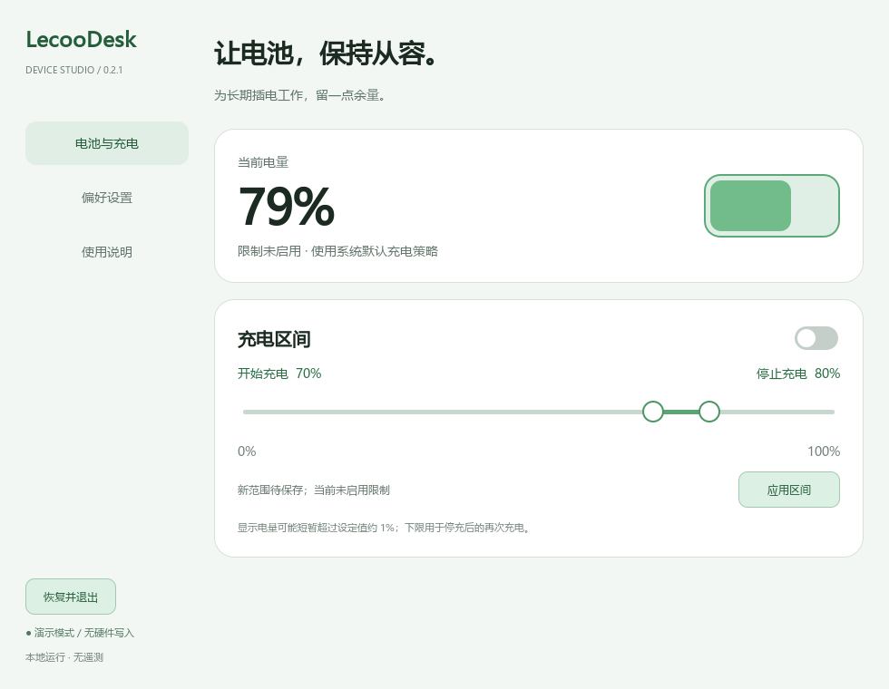
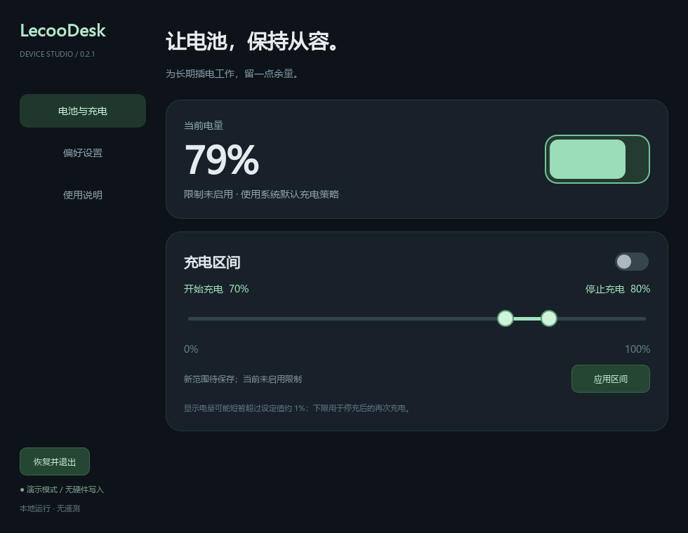

# LecooDesk — 来酷 Pro14 锐龙版（N155A）充电阈值控制工具

为**来酷 Pro14 锐龙版（Lecoo Pro14 Ryzen，型号 N155A）**提供可自定义的电池充电区间控制：设置开始充电和停止充电的百分比，限制电池充电上限，例如设置充电至 80%。目前仅支持下方列出的 BIOS 与硬件组合，属于非官方实验项目。

LecooDesk is an experimental Windows battery charge limit / charging threshold control utility for the Lecoo Pro14 Ryzen (N155A), restricted to the verified BIOS and hardware listed below.

项目采用独立硬件适配器，为后续键盘灯、风扇等底层硬件能力预留扩展边界；这些后续功能尚未实现。

> **严重警告：本项目属于个人实验性质，未经厂商认证。无法保证有效、稳定或安全，可能导致充电异常、系统崩溃、数据丢失甚至硬件损坏，重启不一定恢复。作者不承担使用造成的损失或责任。请保存工作、备份数据，充分理解风险后谨慎使用。**

## 下载

[Windows 打包版下载](https://github.com/chenfind/LecooDesk/releases/latest/download/LecooDesk-Windows.zip) · [所有版本](https://github.com/chenfind/LecooDesk/releases)

程序尚未签名。请完整解压，保留 EXE 旁的 `_internal` 目录。

- `LecooDesk-demo.exe`：模拟硬件，适合先体验界面。
- `LecooDesk.exe`：正式硬件模式，需要管理员权限和本机已有的 inpoutx64 驱动；本项目不安装驱动。
- `LecooDesk-diagnostics.exe`：同样强制模拟硬件，不是实机检测工具。

**当前硬件白名单仅限 N155A / BIOS N155A_00_V1.2_PKID / IT5571-07。其他型号或 BIOS 不应直接使用，也不应通过修改白名单尝试。**

## 界面预览

以下为模拟硬件模式截图，展示浅色与深色主题；电量、温度及阈值不代表当前机器实测结果。

查看深色主题

## 功能

- 0–100% 双滑块，开始和停止阈值至少相差 10 个百分点。
- 启用开关默认关闭，记忆区间和启用偏好。
- 明确区分待应用、已保存和当前生效状态。
- 深色、浅色、跟随系统主题；关闭窗口收起到系统托盘。
- 正常退出尝试恢复启动前的阈值；无独立守护进程。
- 可选开机自启，三级日志及自动保留时长。

调整滑块后点击“应用区间”。“区间已存”表示已保存但限制未启用；“区间生效”表示当前会话已应用。退出请选择托盘“恢复原设置并退出”，关闭窗口不会停止限制。异常退出不能保证恢复。

## 常见问题

### 来酷 Pro14 锐龙版怎么设置电池充电上限？

对于下方兼容范围内的 N155A，可在 LecooDesk 中设置左右阈值，点击“应用区间”后启用充电限制。建议先通过演示版了解界面，并在正式使用前阅读风险提示和[使用说明](docs/USAGE.md)。这不是厂商官方提供的功能。

### N155A 怎么限制充电到 80%？

例如将开始充电设为 70%、停止充电设为 80%，应用区间后启用限制。两个阈值至少相差 10 个百分点。下限用于停充后的再次充电，初次启用时不要求电量先降至下限；显示电量可能短暂超过名义上限，不能保证精确的百分比硬截止。

### 关闭窗口后，充电限制还生效吗？

关闭窗口会收起到系统托盘，程序仍在运行，限制仍然生效。要停止程序并尝试恢复原始阈值，请选择托盘“恢复原设置并退出”。强制结束进程、蓝屏或断电不保证恢复。

### 支持所有来酷 Pro14 或其他来酷笔记本吗？

不支持。目前仅验证 **N155A / BIOS N155A_00_V1.2_PKID / IT5571-07**。相同商品名称也不能替代对型号、BIOS 和芯片的确认。其他 BIOS 或硬件应保持禁用并反馈型号信息，不要修改白名单绕过检查。

### 设置充电上限是否等于电池旁路供电？

不能这样推断。本工具控制充电阈值，不提供物理旁路供电的验证或保证，也不保证电池寿命收益。

### 遇到问题如何反馈？

请在 [Issues](https://github.com/chenfind/LecooDesk/issues) 提供软件版本、确切型号、BIOS 版本、复现步骤和实际表现。日志位置可在设置中查看；发送前检查个人路径等隐私信息。不要上传 BIOS、私人数据或整个用户配置目录。

详见 [使用说明](docs/USAGE.md)、[开发与构建](docs/DEVELOPMENT.md)、[测试边界](docs/TESTING.md) 和 [更新记录](CHANGELOG.md)。

第三方许可见 [THIRD_PARTY_NOTICES.md](THIRD_PARTY_NOTICES.md) 和 `LICENSES/`。项目尚未选择源码授权许可证；公开可见不代表已授予再分发授权。
